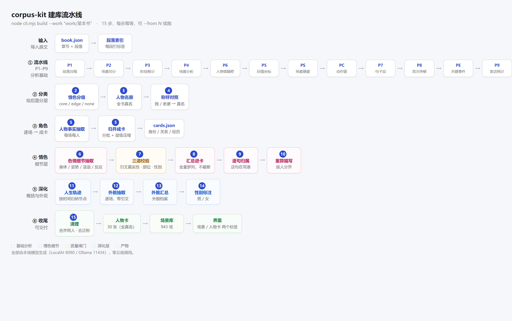

# corpus-kit

把一本中文长篇小说拆成结构化语料：场景、人物、关系、性格、语言、身体与衣着档案，供续写、检索与人物一致性检查使用。

全部由**本地模型**驱动（Ollama / LocalAI 的 OpenAI 兼容接口），不依赖云端 API。



## 它能产出什么

| 层 | 内容 |
|---|---|
| L1 段落 | 每段的功能标签、压缩摘要 |
| L2 场景 | 场景切分、逐场分析（参与者/权力/轨迹/节拍）、摘要、动作链 |
| L3 结构 | 阶段划分、人物弧、关键事件、场景索引 |
| L4 句子 | 逐句抽取与维度标注 |
| 人物卡 | 身份 / 外貌档案 / 性格档案 / 语言档案 / 台词库 / 衣着档案 / 人生轨迹 / 身体档案 / 性反应 |
| 关系图 | 谁是谁的谁，带原文依据 |
| 人称表 | 全书唯一编号 M000001…，带句子号、场景号、映射到的真名 |
| 台词表 | 全书唯一编号 D000001…，带整句上下文、说话人 |
| 人物卡（按场景） | 11 项概述 + 13 类档案，条目带原文摘句与句子号 |

每类信息都带**场次号 / 句子号**，界面里一键跳回原文核对。

## 快速开始

需要 Node.js ≥ 20，无需安装依赖。

```bash
# 1. 导入一本 txt（章节格式自动识别）
node cli.mjs init --file 你的书.txt --work work/我的书 --force

# 2. 一条命令跑完整条流水线
node cli.mjs build --work work/我的书 --config config.gateway.json

# 3. 打开界面
node app.mjs --root work --port 4173
```

浏览器打开 http://127.0.0.1:4173 。

## 接本地模型

复制 `config.example.json` 为 `config.gateway.json`，按你的服务改：

```json
{
  "provider": "gateway",
  "gatewayBaseUrl": "http://127.0.0.1:8090/v1",
  "apiKey": "local",
  "model": "qwen3.5:9b-uncensored",
  "timeoutMs": 900000,
  "concurrency": 1
}
```

也支持直连 Ollama：

```json
{ "provider": "ollama", "baseUrl": "http://127.0.0.1:11434", "model": "qwen3.5:9b-uncensored" }
```

> Qwen3 系模型走 OpenAI 兼容层时必须带 `reasoning_effort: "none"` 才能关闭思考，否则 `content` 返回空。本工具默认已加。

## 建库流水线

`node cli.mjs build` 按依赖顺序跑 35 步，每步幂等（已有产物自动跳过），中断后用 `--from N` 接着跑。

```
基础流水线   P1 段落索引 → P2 场景切分 → P3 阶段粗分 → P4 场景分析
            P6 人物弧 → P5 回填坐标 → PS 场景摘要 → PC 动作链
            P7 句子层 → P8 首次突破 → PE 关键事件 → P9 套话统计

分类        情色分级 · 人物名册 · 称呼对照

角色        人物事实逐场抽取 → 归并成卡 → 人物关系图 → 关系校正

情色        色情细节抽取 → 引文校验（真实性/部位/性别）→ 汇总
            性爱描写逐句归属 → 汇总

深化        人生轨迹 · 外貌抽取/汇总 · 衣着抽取/汇总/情境
            全书台词归属 · 台词库汇总 · 语言档案 · 性格档案 · 性别标注

收尾        合并同人 · 去泛称
```

每一步都能在界面「工作流水线」里单独点击执行，状态用颜色区分：灰=未开始，蓝=进行中，绿=完成，红=失败；上游没完成会直接提示缺哪一步。

## 三道质量闸门

结构化数据最容易"编"和"串"。这三道校验是确定性的，不花模型调用：

1. **引文真实性**：每条引用必须是原文逐字子串，不在原文里直接删掉
2. **部位匹配**：写"阴户"的引文里必须出现穴/花瓣/私处等词，否则判为归错部位
3. **性别一致性**：女性专属部位不能挂到男性名下，错了改挂或丢弃

## 人物关系图

没有先抽关系，后面所有档案都会把"丈夫"和"奸夫"混成一个人。所以人物关系是独立一步：

```
「我的妻子叫解婧」     → 余学君 —夫妻→ 解婧
「我的妹妹叫余柳薇」   → 余学君 —兄妹→ 余柳薇
「吴德的儿子吴守成」   → 吴德 —父子→ 吴守成
```

每条边带原文出处；生成性格/语言档案时把关系表注入提示词，强制"配偶只能写配偶，情人只能写对应的人"。

## 目录结构

```
cli.mjs     命令行入口（init/add/run/build/status/cards/analyze/serve/advise）
app.mjs     本地服务与 Web 界面
core/       流水线、切分、提示词、校验、人物卡、关系、顾问
tools/      独立工具（建库编排、各类抽取、质量校验、发布打包）
ui/         前端（无需构建，原生 ESM）
samples/    示例文本
work/       书目数据（不入库）
docs/       架构说明
```

## 主要命令

```bash
node cli.mjs build   --work work/书 [--from N] [--dry]   # 一键建库
node cli.mjs run     --work work/书                      # 只跑 P1–P9
node cli.mjs cards   --work work/书                      # 只跑人物卡
node cli.mjs analyze --work work/书                      # 逐场分析（可暂停/续跑）
node cli.mjs pause   --work work/书 [--off]              # 暂停 / 恢复
node cli.mjs check   --work work/书                      # 检查产物完整性
node cli.mjs export  --work work/书                      # 导出结构化结果
node app.mjs --root work --port 4173                     # 起界面
```

## 界面

十二个标签页，按依赖顺序：

```
0. 工作流水线   节点对应下面各步，点哪个跑哪个
1. 小说清洗     导入 txt → 建书籍工程（book.json：书名/目录/正文）
2. 内容编号     段落、句子编号
3. 场景切分     模型找切分点，20 句起合并，SC001…
4. 生成角色     真名表 → 场景内人称 → 人称映射
5. 场景详述     逐场生成情节步骤与人物，侧栏实时显示角色与关系
5.1 角色纠错    按章用 DeepSeek 复核角色与关系，可审计、可手改
5.2 人称关联    全书人称编号 M000001…，逐场映射到真名
5.3 关系重构    按章复核映射；三栏：原文（带编号）/ 映射详情 / 改动记录
6.1 角色人物卡  按场景梳理角色：概述 + 档案，条目带原文
6.2 人物语言    全文对话编号 D000001…，按角色聚合台词
6. 角色重构     旧的关系重建流程
```

## 角色与人称数据链

```
4 生成角色     真名 + 代称 + 人物关系
      ↓
5 场景详述     按场写情节，逐步补角色
      ↓
5.1 角色纠错   按章复核：真名优先、代称并入、关系唯一
      ↓
5.2 人称关联   给每个人称出现编号（M 编号），映射到真名
      ↓
5.3 关系重构   结合上下文复核 M 编号 → 真名，可手改
      ↓
6.1 人物卡     按场景生成角色档案（输入只含本场角色与人称映射）
6.2 人物语言   给每句对话编号（D 编号），判定说话人
```

各步骤的输入范围有硬约束：6.1 只发送该场景的角色真名与该场景的人称映射；6.2 只发送该场景的对话与整句上下文。不把全书数据一次性塞给模型。

## 模型分工

```
本地 9B Q8 64K   人称映射、角色人物卡（逐场、长文本、可离线）
DeepSeek 云端    角色纠错、关系重构、对话说话人判定（需要推理与稳定 JSON）
```

云端请求同样经 LocalAI 转发，调用方只需 LocalAI 网关密钥。纠错模型可用环境变量切换：

```bash
CORRECT_MODEL=deepseek-v4-pro node tools/correct-roles-per-chapter.mjs work/书
```

## 性能参考

单机（LocalAI + Qwen3.5-9B，串行）跑一本 77 万字 / 943 场的书：

```
场景分析      943 次调用   约 6 小时
人物卡        943 次调用   约 3 小时
色情细节      465 次调用   约 1.5 小时
逐句归属      471 次调用   约 20 分钟
台词归属      796 次调用   约 40 分钟
全流程        约 14 小时（可断点续跑）
```

27B 模型质量更好但慢约 10 倍，适合单人档案重算与顾问建议，不适合全量流水线。

## 许可

MIT，见 [LICENSE](LICENSE)。架构细节见 [docs/ARCHITECTURE.md](docs/ARCHITECTURE.md)。
